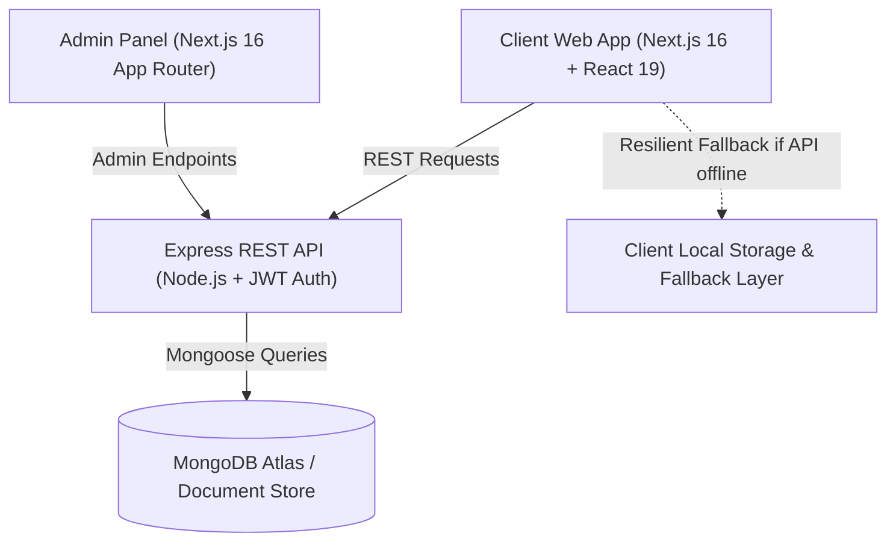

# 🍹 SPRYO — Modern Full-Stack E-Commerce Beverage Platform

[](https://nextjs.org/)
[](https://react.dev/)
[](https://tailwindcss.com/)
[](https://nodejs.org/)
[](https://expressjs.com/)
[](https://mongodb.com/)
[](https://vercel.com/)
[](https://opensource.org/licenses/MIT)

> **SPRYO** is a high-performance, full-stack direct-to-consumer (D2C) e-commerce platform built for craft sparkling drinks. Engineered with **Next.js 16 (App Router + Turbopack)**, **React 19**, **Node.js/Express**, and **MongoDB**, featuring real-time state management, resilient offline-first fallbacks, dynamic JWT authentication, and responsive cross-device layouts (Mobile, iPad, Surface Pro, Desktop).

---

## 🌟 Live Links & Demo

- 🚀 **Storefront Web App:** [https://spryo-client-git-vercel-react-server-com-bc3387-spryos-projects.vercel.app](https://spryo-client-git-vercel-react-server-com-bc3387-spryos-projects.vercel.app/)
- ⚙️ **Admin Dashboard:** Deployable via `/admin`
- 🔌 **Backend API:** Node.js/Express server on `/backend`

---

## 🏗️ Architecture & Engineering Highlights



### 1. 🛡️ Resilient Zero-Breakdown Architecture
Designed for high uptime and portfolio demonstrations:
- Every dynamic route (`/products`, `/product/[id]`, `/orders`, `/profile`, `/checkout`) attempts live backend REST communication first.
- If the backend or MongoDB instance is sleeping or unreachable, the application **automatically falls back to client cache & structured data**, ensuring recruiters and visitors never experience blank screens or unhandled errors.

### 2. 🔐 Authentication & Session Synchronization
- Real **JWT (JSON Web Token)** authentication flow with password encryption.
- Seamless multi-tab session synchronization via custom window event dispatchers (`spryo_auth_change`) and `storage` listeners.
- Instant Navbar avatar & profile hydration upon login/logout without requiring full-page reloads.

### 3. 📱 Device-Specific Responsive Engineering
- **Mobile (<640px):** Single-column stacked layouts, touch-friendly tap targets, and streamlined drawers.
- **Tablets & 2-in-1s (iPad Mini 768px, Surface Pro 960px, iPad Pro 1032px/1376px):**
  - **Collapsible Swiper Accordion Footer:** Prevents horizontal crowding and sticky back-to-top button overlap on 768px–1024px screens.
  - **Bento Grid Profile Dashboard:** Replaces narrow fixed sidebars with an adaptive 4-KPI stat row and balanced dual-column cards, preventing empty vertical void on tall screens.
- **Desktop (1024px+):** Generous glassmorphism padding, subtle ambient lighting, and fluid hover micro-interactions.

### 4. 🌗 Light & Dark Mode Engine
- Native CSS custom properties coupled with `[data-theme="light"]` selectors.
- Strict high-contrast typography in light mode (deep slate `#0f172a` instead of washed-out grays).
- Zero-flash theme hydration on initial page load with preference persistence.

---

## ⚡ Core Features & Modules

### 🛒 D2C Storefront Experience
- **Interactive Flavor Visualizer:** Real-time hero switcher toggling between *Classic Cola*, *Cloudy Lemon*, *Zesty Orange*, and *Mountain Up* with dynamic color themes and ambient auras.
- **Dynamic Crate & Cart Engine:** Real-time quantity adjustments, subtotal & tax calculations, free delivery threshold progress bar, and toast feedback.
- **Smart Discount & Promo Engine:** Real promo codes (`SPRYO20` for 20% off, `COLA3FOR2`, `FIZZUP`, `WELCOME10`) with one-click copy to clipboard.
- **Catalog Filtering:** Real-time text search, category pills, price low-to-high sorting, and dynamic ratings.
- **Single Product Pages (`/product/[id]`):** Ingredients breakdown, nutrition information, customer review submissions, and related bottle suggestions.
- **End-to-End Checkout & Orders:**
  - Validated shipping address form.
  - Live order creation with unique tracking IDs (`SPRYO-XXXXXX`).
  - Dedicated `/orders` dashboard with live status pills (Placed, Processing, Shipped, Delivered) and **1-click Reorder** action.
- **Mixology & Recipes (`/recipes`):** Handcrafted cocktail & mocktail serving guides with step-by-step instructions.

---

## 🛠️ Technology Stack

| Domain | Technology | Key Role |
| :--- | :--- | :--- |
| **Frontend Framework** | **Next.js 16.0.6 (Turbopack)** | Server & Client components, App Router, SSG/SSR |
| **UI Library** | **React 19.2.0** | Modern component architecture, React hooks |
| **Styling** | **Tailwind CSS v4 + Vanilla CSS Modules** | Zero-bloat utility styles + custom theme design system |
| **Icons** | **React Icons (FontAwesome / Feather)** | Lightweight SVGs |
| **Backend** | **Node.js + Express 5** | REST API endpoints, routing, and controllers |
| **Database** | **MongoDB Atlas + Mongoose** | Cloud document database with connection pooling |
| **Security** | **JWT + bcryptjs** | Token-based auth and credential protection |
| **Deployment** | **Vercel + Render** | Edge deployment for Next.js and API web service |

---

## 📁 Monorepo Directory Structure

```plaintext
VeggieWave/ (SPRYO)
├── client/                     # Customer Storefront (Next.js 16 + React 19)
│   ├── public/                 # Static brand assets (drink bottles, badges, favicon)
│   ├── src/
│   │   ├── app/                # Next.js App Router (23 production routes)
│   │   │   ├── (auth)/         # /login, /signup, /profile
│   │   │   ├── products/       # /products (catalog & filters)
│   │   │   ├── product/[id]/   # Dynamic single product detail & reviews
│   │   │   ├── cart/           # /cart (crate manager & delivery progress)
│   │   │   ├── checkout/       # /checkout & /checkout/success
│   │   │   ├── orders/         # /orders (order history & reordering)
│   │   │   ├── recipes/        # /recipes & /recipes/[id]/view
│   │   │   ├── offers/         # /offers (discount codes & copy triggers)
│   │   │   └── ...             # /about, /careers, /distributor, /faq, /terms, /privacy
│   │   ├── components/         # Reusable UI (Header, Footer, CartContext, ThemeContext, Toast)
│   │   ├── styles/             # Modular CSS styling and responsive breakpoints
│   │   └── lib/                # Client API fetch wrappers and auth state helpers
│   ├── .env.example
│   └── package.json
│
├── admin/                      # Operations & Store Manager Dashboard
│   ├── src/app/admin/          # Revenue analytics, orders management, inventory table
│   ├── .env.example
│   └── package.json
│
├── backend/                    # Express REST API
│   ├── config/                 # MongoDB database connection
│   ├── controllers/            # Auth, Product, Order, Review controllers
│   ├── middleware/             # JWT auth & error handling middleware
│   ├── models/                 # Mongoose schemas (User, Product, Order)
│   ├── routes/                 # Express REST route handlers
│   ├── server.mjs              # Server entry point
│   ├── .env.example
│   └── package.json
│
├── package.json                # Root monorepo workspace scripts
└── README.md                   # Project documentation
```

---

## 🚀 Local Development Setup

### Prerequisites
- **Node.js** >= 18.x
- **npm** >= 9.x
- **MongoDB** (Local instance or MongoDB Atlas URI)

### 1. Clone the repository
```bash
git clone https://github.com/tisamodi123/Spryo.git
cd Spryo
```

### 2. Environment Configuration

#### Backend (`backend/.env`):
```env
PORT=2002
NODE_ENV=development
MONGO_URI=mongodb://localhost:27017/veggiewave
JWT_SECRET=your_jwt_secret_key_here
CLIENT_URL=http://localhost:3000
```

#### Client (`client/.env.local`):
```env
NEXT_PUBLIC_API_URL=http://localhost:2002/api
```

### 3. Run Applications
```bash
# Run Client Storefront (http://localhost:3000 or 3001)
npm run dev:client

# Run Backend API Server (http://localhost:2002)
npm run dev:backend

# Run Admin Panel (Optional, http://localhost:3002)
npm run dev:admin
```

---

## 🌐 Production Deployment

### Client on Vercel:
1. Connect this repo to [Vercel](https://vercel.com/).
2. Set **Root Directory** to `client`.
3. Add Environment Variable: `NEXT_PUBLIC_API_URL` pointing to your deployed backend.
4. Click **Deploy** (Production build compiles 23/23 routes with 0 errors).

### Backend on Render / Railway:
1. Create a **Web Service** pointing to `backend`.
2. Set Build Command: `npm install` and Start Command: `node server.mjs`.
3. Add `MONGO_URI` and `JWT_SECRET` environment variables.

---

## 📄 License
This project is open-source and available under the [MIT License](LICENSE).

<p align="center">
  <b>SPRYO</b> — Crafted with precision for the modern craft beverage generation.
</p>
